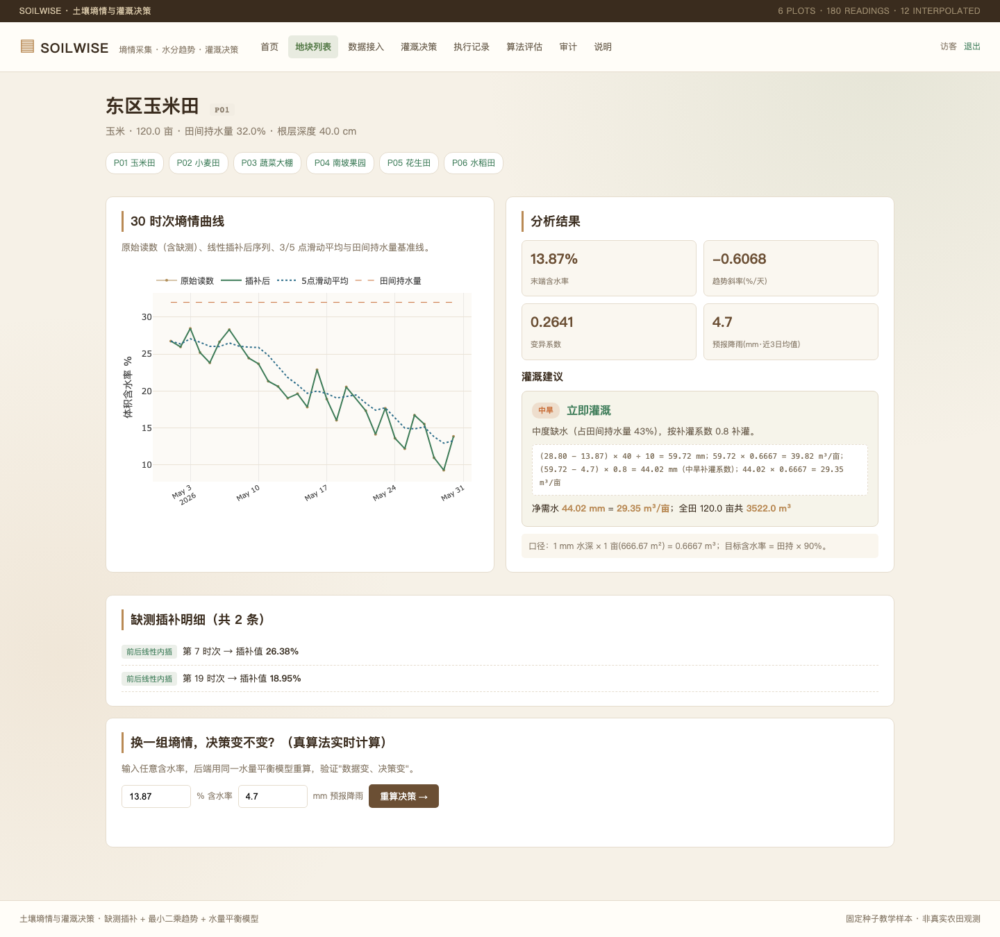
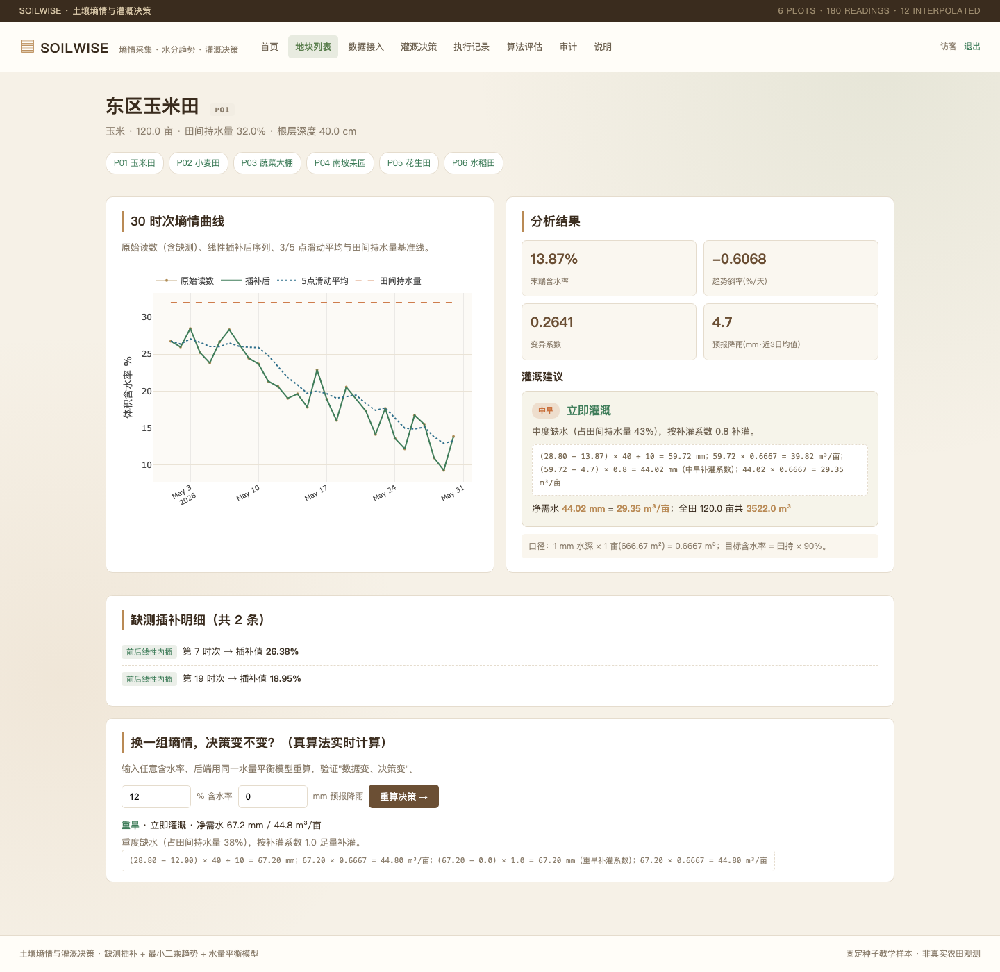
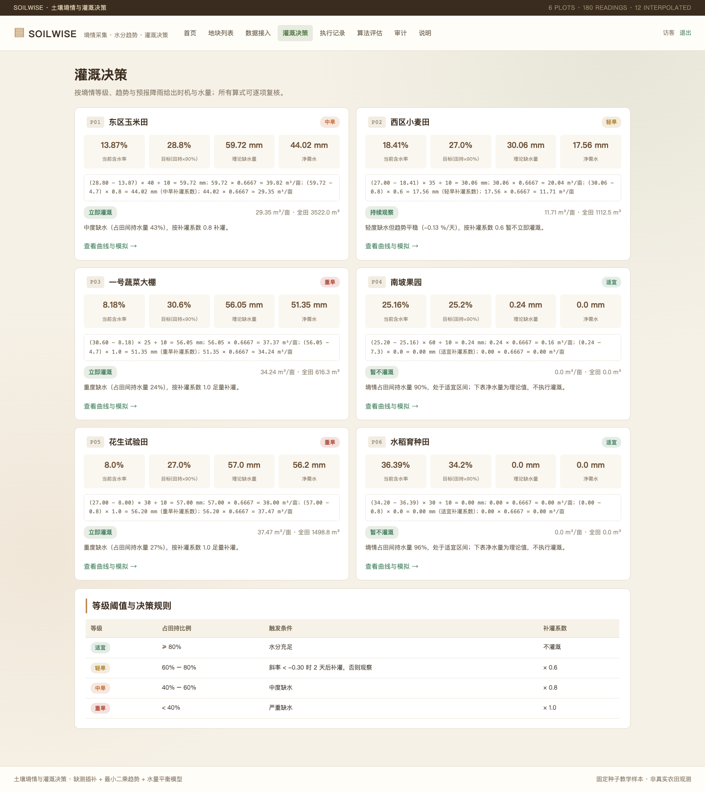
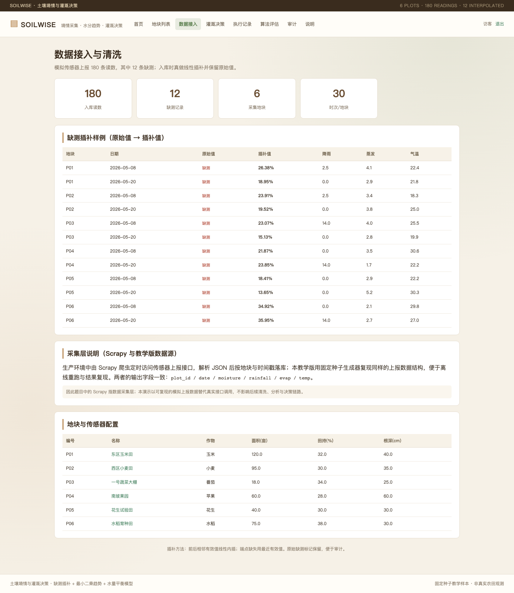
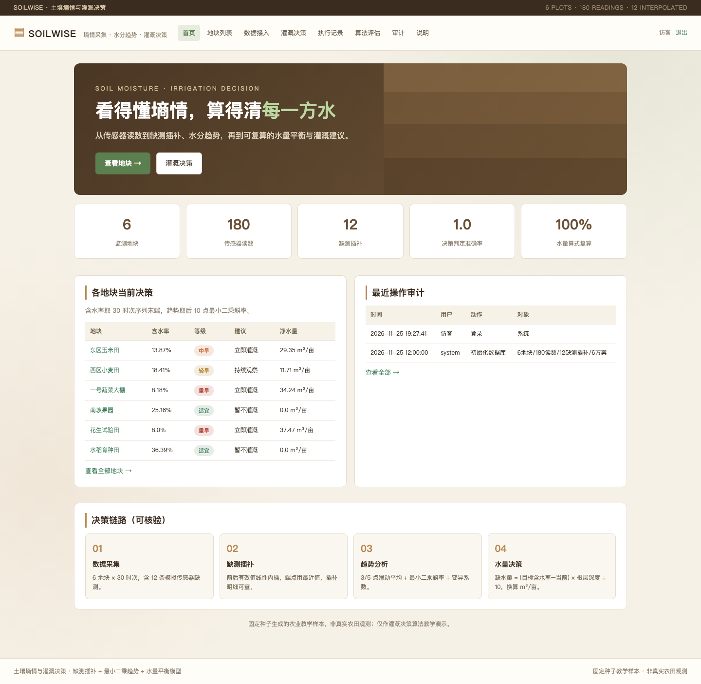
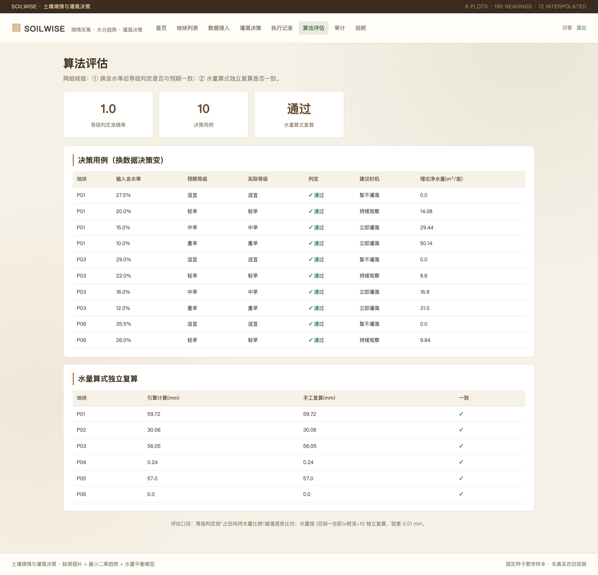

# 093 基于Scrapy与Django的土壤墒情与灌溉决策系统-设计展示

> **代码有偿获取 可接受定制 微信联系方式: csbysj2020 或 ACE2487，备注(BS)**

> **完整源码与全套文档 · 在线自助获取 >>> [https://mbd.pub/o/bread/YZaWmZlraw==](https://mbd.pub/o/bread/YZaWmZlraw==)**

> **成品页（功能介绍 / 更多选题）>>> [https://bishe.suilang.net/products/soilwise](https://bishe.suilang.net/products/soilwise)**

> 

> 

## 视频

> **点击查看 >>> [https://www.bilibili.com/video/BV1xvykzsEwr/](https://www.bilibili.com/video/BV1xvykzsEwr/)**

## 项目简介

棕绿土壤仪表盘视觉。6 地块 × 30 时次共 180 条传感器读数（含 12 条模拟缺测），前后有效值线性插补；3/5 点滑动平均 + 最小二乘趋势斜率；水量平衡模型（目标=田持×90%，缺水量(mm)=(目标−当前)×根深÷10，1 mm×1亩=0.6667 m³）+ 四级墒情阈值与趋势修正，给出灌溉时机与水量。10 用例准确率 1.0，6 组水量复算全一致；决策模拟实测 13.87%→12% 时等级中旱→重旱、水量 29.35→44.8 m³/亩。Django+SQLite+Plotly，10 页面。固定种子教学样本，非真实农田观测。

土壤墒情传感器数据存在缺测与噪声，直接影响灌溉决策的可靠性与用水量口径。

本项目设计并实现一套土壤墒情与灌溉决策系统：以固定种子生成的 6 块农田、180 条传感器读数（含 12 条模拟缺测）为数据，采用前后有效值线性内插完成缺测清洗，以 3/5 点滑动平均与最小二乘斜率分析水分趋势，基于土壤水量平衡模型计算缺水量——目标含水率为田间持水量的 90%，缺水量(mm) =（目标 − 当前）× 根层深度(cm) ÷ 10，并按 1 mm × 1 亩 = 0.6667 m³ 换算用水量；结合四级墒情阈值、趋势修正与预报降雨给出灌溉时机与水量建议。

数据采集层采用 Scrapy 定时访问传感器上报接口并解析入湖，教学版以固定种子生成器复现同结构数据；系统采用 Django + SQLite + Plotly.js 实现，含数据接入、地块曲线、缺测明细、决策模拟、执行记录与审计等功能。

本仓库为**设计展示**：包含项目说明、技术架构、实验结果与运行截图；完整源码、任务书、开题报告、毕业论文与使用说明可通过上方链接自助获取，成品页可查看更多选题，也可联系微信咨询定制。

## 功能特性

1. 真缺测插补：12 条模拟缺测用前后有效值线性内插，原始标记保留，插补值逐条可查

2. 真时序分析：3/5 点滑动平均 + 后 10 点最小二乘斜率 + 变异系数，曲线四线对照

3. 水量平衡模型：缺水量(mm)=(目标−当前)×根层深度÷10，逐项展示算式，口径统一

4. 灌溉决策：四级墒情阈值 + 趋势修正时机 + 补灌系数 + 扣预报降雨，6 地块决策各异

5. 决策模拟：输入任意含水率实时重算，实测换数据后等级与水量均变化

6. 算法评估：10 组决策用例准确率 1.0，6 组水量算式独立复算全部一致

7. 完整闭环：数据接入、地块曲线、决策总览、执行记录与审计，10 页面

## 技术架构

| 项目 | 说明 |
| --- | --- |
| 编程语言 | Python 3.8+ |
| Web 框架 | Django 4 + Jinja2 |
| 核心引擎 | analytics/irrigation.py（插补+趋势+水量平衡+决策） |
| 数据库 | SQLite（6表） |
| 可视化 | Plotly.js |
| 端口 | http://127.0.0.1:8093 |
| 演示账号 | user/user123、admin/admin123 |

## 目录结构

以下为完整交付版的结构（本仓库仅作设计展示）：

```
soilwise/
├── analytics/
│   └── irrigation.py
├── data/
│   ├── analysis/
│   │   ├── decision_eval.json
│   │   ├── decisions.json
│   │   ├── series.json
│   │   └── water_checks.json
│   ├── processed/
│   │   ├── decision_cases.csv
│   │   ├── plots.csv
│   │   └── readings.csv
│   ├── soil_kg.db
│   └── stats.json
├── soilproj/
│   ├── __init__.py
│   ├── settings.py
│   ├── urls.py
│   └── wsgi.py
├── soilweb/
│   ├── __init__.py
│   ├── db.py
│   └── views.py
├── static/
│   ├── css/
│   │   └── style.css
│   └── vendor/
│       └── plotly.min.js
├── templates/
│   ├── about.html
│   ├── audit.html
│   ├── base.html
│   ├── decision.html
│   ├── evaluation.html
│   ├── executed.html
│   ├── ingest.html
│   ├── login.html
│   ├── overview.html
│   ├── plot_detail.html
│   └── plots.html
├── 任务书/
│   └── 毕业设计任务书.docx
└── …
```

## 数据与实验结论

- 10 组决策用例的等级判定准确率为 1.0，6 组水量算式独立复算全部一致。
- 真缺测插补：12 条模拟缺测用前后有效值线性内插，原始标记保留，插补值逐条可查
- 真时序分析：3/5 点滑动平均 + 后 10 点最小二乘斜率 + 变异系数，曲线四线对照
- 水量平衡模型：缺水量(mm)=(目标−当前)×根层深度÷10，逐项展示算式，口径统一

## 交付内容

1. 完整源码（采集/清洗/分析/决策引擎+Django+SQLite）
2. 真实数据（6地块/180读数/12缺测/10用例）
3. 任务书与开题报告（Word）
4. 毕业论文（Word七章制）
5. 二次开发说明（Word+md）
6. 11张桌面截图+封面+101s视频

## 常见问题

**缺测数据怎么处理？**

前后有效值线性内插，端点用最近值；原始缺测标记保留可审计。

**用水量怎么算？**

(目标−当前)×根深÷10 得 mm，再乘 0.6667 得 m³/亩；页面逐项展示算式。

**数据是真实农田吗？**

固定种子 189 生成的教学样本，非真实农田观测，不代表实际灌溉建议。

**决策会随数据变化吗？**

会。地块页可输入任意含水率实时重算，等级与水量均随输入变化。

## 截图







